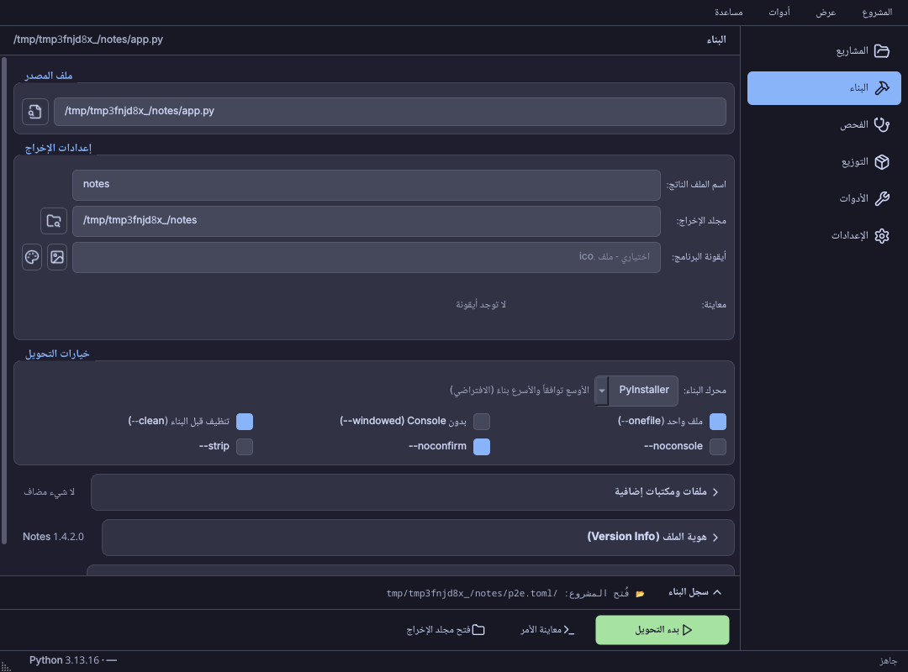
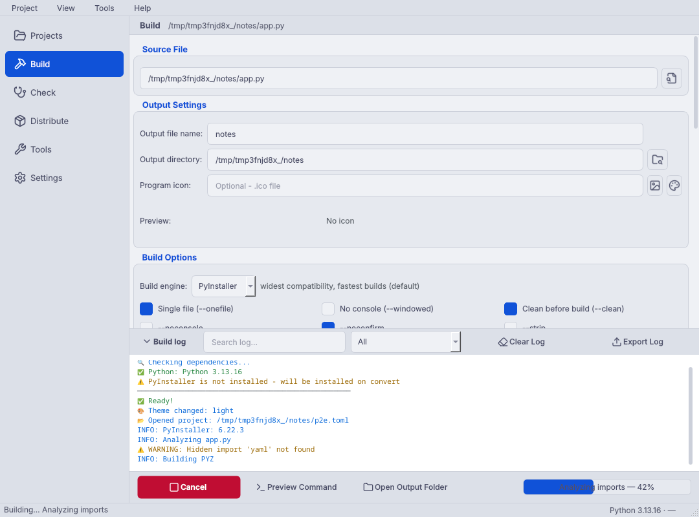

<div align="center">

# 🐍 Python to EXE Converter

### أداة احترافية لتحويل تطبيقات بايثون إلى ملفات تنفيذية


<br>

**حوّل أي ملف Python إلى ملف EXE بضغطة زر — مع طبيب مشروع يكتشف ما سيكسر الـ EXE قبل البناء ويصلحه بنقرة، تشخيص تلقائي لأعطال التشغيل، استوديو أيقونات، واجهة عربية كاملة، تحويل دفعي، توقيع رقمي، ومثبّت كامل.**

[الميزات](#-الميزات) •
[التثبيت](#-التثبيت) •
[الاستخدام](#-الاستخدام) •
[القوالب](#-القوالب-الجاهزة) •
[خارطة الطريق](#-خارطة-الطريق) •
[المساهمة](#-المساهمة)

> 🇬🇧 **English:** see [README_EN.md](README_EN.md)

</div>

---

## 📖 نظرة عامة

**Python to EXE Converter** هي أداة احترافية مفتوحة المصدر لتحويل ملفات بايثون (`.py`) إلى ملفات تنفيذية (`.exe`) بدون أوامر سطر الأوامر.

تجمع الأداة بين سهولة الاستخدام (واجهة عربية/إنجليزية ثنائية الاتجاه) والقوة الكاملة لـ PyInstaller، مع إضافات احترافية مثل التوقيع الرقمي، محرر metadata، سجل البناءات السابقة، ومحلل تبعيات ذكي يعتمد على AST.

---

## ✨ الميزات

<table>
<tr>
<td width="50%">

### 🎨 الواجهة والتجربة
- ✅ واجهة عربية (RTL) + إنجليزية (LTR)
- ✅ **شريط جانبي بستة أقسام** (2.1) بدل 15 تبويباً: المشاريع، البناء، الفحص، التوزيع، الأدوات، الإعدادات
- ✅ **صفحة بناء بأقسام مطوية** (2.1): المبتدئ يرى أربعة حقول، والخيارات المتقدمة تُفتح في مكانها
- ✅ **أيقونات SVG** (Lucide) تتلوّن مع السمة (2.1) بدل الإيموجي
- ✅ **4 سمات**: داكنة، نهارية، Nord، تباين عالٍ + تلقائي حسب النظام
- ✅ **تكبير/تصغير الخط** (Ctrl + / -)
- ✅ السحب والإفلات (Drag & Drop)
- ✅ معاينة الأمر قبل التنفيذ (Dry-run)
- ✅ **سجل بناء كلوحة سفلية** (2.1) مرئي من كل قسم، ملوّن + بحث + **تصفية حسب النوع** + تصدير
- ✅ **معاينة الأيقونة** بأربعة أحجام
- ✅ 20+ اختصار لوحة مفاتيح (F1 يعرضها كلها)

</td>
<td width="50%">

### 🔍 محلل التبعيات الذكي
- ✅ كشف بـ AST (داخل الدوال والشروط)
- ✅ يكشف `__import__` و `importlib`
- ✅ استيراد من `requirements.txt`
- ✅ تصفية تلقائية للمكتبات القياسية

</td>
</tr>
<tr>
<td width="50%">

### 📝 metadata الاحترافية
- ✅ محرر Version Info (8 حقول)
- ✅ تضمين CompanyName، Copyright، Product
- ✅ تظهر في خصائص EXE في Windows
- ✅ توليد `version.txt` تلقائي

</td>
<td width="50%">

### 🚀 ميزات النشر
- ✅ شاشة بداية (Splash screen)
- ✅ Windows Manifest (DPI، UAC، OS)
- ✅ توقيع رقمي (signtool.exe)
- ✅ اختبار ما بعد البناء
- ✅ **مثبّت كامل (Inno Setup)** — من `.py` إلى `Setup.exe`
- ✅ **تنبيه واضح للميزات الخاصة بـ Windows** على Linux/macOS

</td>
</tr>
<tr>
<td width="50%">

### 🕓 سجل البناءات والإعدادات
- ✅ آخر 20 عملية بناء محفوظة
- ✅ استعادة الإعدادات بنقرة واحدة
- ✅ **إعدادات محفوظة بأسماء (Presets)**
- ✅ تصدير/استيراد الإعدادات للمشاركة

</td>
<td width="50%">

### 📦 البناء والإنتاجية
- ✅ ملف واحد أو مجلد، مع/بدون Console
- ✅ أيقونة (.ico) + ملفات إضافية
- ✅ Hidden Imports + UPX + Optimize
- ✅ **تحويل دفعي** لعدة ملفات دفعة واحدة
- ✅ **شريط تقدم حقيقي** يتبع مراحل PyInstaller
- ✅ **إشعارات نظام** عند انتهاء البناء

</td>
</tr>
<tr>
<td width="50%">

### 🩺 طبيب المشروع (جديد في 1.3)
- ✅ **فحص قبل البناء** لما يعمل في بايثون وينكسر بعد التحويل
- ✅ **درجة جاهزية** من 100 وإصلاح بنقرة
- ✅ مكتبات غير مثبتة، ملفات بيانات غير مضمّنة، مسارات نسبية،
  `multiprocessing` بلا `freeze_support`، `input()` في تطبيق بلا Console
- ✅ **قاعدة معرفة** لـ 45 مكتبة شائعة وما تحتاجه (ملف JSON مفتوح)

</td>
<td width="50%">

### 🔁 التشخيص والإصلاح التلقائي (جديد في 1.3)
- ✅ قراءة أخطاء **سجل البناء** و`warn-*.txt` (ما يخص كودك فقط)
- ✅ قراءة **الـ traceback من الـ EXE** نفسه وشرحه بالعربية
- ✅ **تشغيل تشخيصي** يكشف الخطأ المخفي في التطبيقات بلا Console
- ✅ زر **«طبّق وأعد البناء»**
- ✅ **🎨 استوديو الأيقونات**: `.ico` حقيقي بـ 7 أحجام من صورة أو حروف

</td>
</tr>
<tr>
<td width="50%">

### 🧪 بيئة بناء معزولة (جديد في 1.4)
- ✅ بيئة لكل مشروع تحوي **فقط** ما يستورده (بما فيه ما تستورده ملفاته المساعدة)
- ✅ تُنشأ بـ `uv` إن وُجد (ثوانٍ) أو `venv` + pip، **بعد موافقتك على الأوامر**
- ✅ **ملف قفل** `p2e-build.lock` لبناء قابل للتكرار على أي جهاز
- ✅ **🧊 اختبار في Windows Sandbox** على Windows نظيف بلا بايثون

</td>
<td width="50%">

### 📏 مختبر الحجم وتقرير البناء (جديد في 1.4)
- ✅ ما بداخل الـ EXE **مكتبةً مكتبة** بالميغابايت
- ✅ **مقترحات تنحيف** (`--exclude-module`) بنقرة + مقارنة بالبناء السابق
- ✅ مثال حقيقي: تطبيق Pillow من **30.1MB إلى 14.2MB (−53%)** ببيئة معزولة
- ✅ **تقرير HTML** لكل بناء: الحجم، المكتبات، SHA-256، الإصدارات، الملاحظات

</td>
</tr>
<tr>
<td width="50%">

### 🧰 مكتبة التشغيل المدمجة (جديد في 1.5)
- ✅ حزمة `p2e_runtime` تُضمَّن **اختيارياً** داخل برنامجك، كل خدمة بمربع اختيار
- ✅ `resource_path()` · **ملف سجل** للتطبيق بلا Console · **مُبلِّغ انهيار**
  يحفظ تقريراً ويخبر المستخدم أين · **نسخة واحدة فقط**
- ✅ مكتبة قياسية فقط، Python 3.8+، تعمل مع tkinter وQt وأي تطبيق
- ✅ **لا شيء مفعّل افتراضياً، ولا قياس استخدام، ولا شبكة** دون رابط تضبطه أنت

</td>
<td width="50%">

### 🔄 المحدِّث الذاتي الموقَّع (جديد في 1.5)
- ✅ `update.json` موقَّع بـ **Ed25519** (تحقق ببايثون خالص، يجتاز متجهات RFC 8032)
- ✅ **HTTPS فقط**، ويُرفض أي تحويل إلى HTTP، ويُتحقق من الحجم وSHA-256 قبل الاستبدال
- ✅ استبدال الـ EXE وإعادة تشغيله (ملف واحد) أو تشغيل مثبّت موقَّع (بناء مجلد)
- ✅ مفتاحك الخاص في مجلد إعداداتك فقط + زر **«إنشاء update.json موقَّع»**

</td>
</tr>
<tr>
<td width="50%">

### ⚙️ محرك Nuitka (جديد في 2.0)
- ✅ اختر **PyInstaller** أو **Nuitka** من الإعدادات الرئيسية (`engine` في `p2e.toml`،
  أو `py2exe-gui build --engine nuitka`)
- ✅ Nuitka يترجم وحدات برنامجك إلى C مُصرَّف: غالباً بلاغات كاذبة أقل من مكافحات
  الفيروسات، واستخراج الكود **أصعب لا مستحيل**؛ والبناء أبطأ لأنه يشغّل مترجم C
- ✅ ما لا يدعمه المحرك يُعلَن قبل البناء (مكتبة التشغيل، الـ Manifest...)، والإصلاحات
  تُترجم إلى خيارات Nuitka أو تُعلَّم بأنها بلا مقابل — لا يُمرَّر خيار لمحرك لا يملكه
- ✅ الطبيب يفحص المترجم (MSVC/MinGW على Windows، gcc/clang غيره)، وإصدار Python،
  و`patchelf`/`readelf` على Linux
- ✅ **لا تنزيل دون موافقتك:** إن طلب Nuitka تنزيل أداة يُسأل المستخدم، ولهذا البناء فقط

### 📁 ملف المشروع وسطر الأوامر (جديد في 1.6)
- ✅ ملف **`p2e.toml`** واحد في مستودعك يصف المشروع كله: البناء، معلومات
  الإصدار، الـ Manifest، المثبّت، التوقيع (بلا كلمة المرور)، مكتبة التشغيل والإصدار
- ✅ المسارات نسبية إلى الملف، فالنسخة المستنسخة تُبنى بالطريقة نفسها
- ✅ **سطر أوامر** بلا واجهة: `init` · `doctor` · `build` · `size` · `compare` · `env` ·
  `release` · `package` · `ci` — يعمل في CI دون PyQt5

### 🌍 كل المنصات (جديد في 2.0)
- ✅ **حزم Linux وmacOS** من البناء نفسه: **AppImage** (appimagetool) و**`.deb`**
  (dpkg-deb مع `control` ومدخل `.desktop` وأيقونة) و**`.dmg`** (hdiutil وحزمة `.app`)،
  من تبويب «المنصات» أو `py2exe-gui package`، وتُرفع مع الإصدار
- ✅ **مولّد GitHub Actions**: `py2exe-gui ci` يكتب `p2e-release.yml` في مستودعك —
  مصفوفة Windows/macOS/Linux، تخزين مؤقت لـ pip والبناء، artifacts، وإصدار GitHub
  عند دفع وسم `v*` — بعد معاينة الملف كاملاً وموافقتك
- ✅ **لا سر في أي ملف:** الشهادات وكلمات المرور تُذكر بالاسم `${{ secrets.NAME }}`
  فقط، واختبار يتحقق أن قيماً تشبه الأسرار لا تصل إلى الملف المولَّد
- ✅ **لا تنزيل دون موافقتك:** appimagetool وملف runtime يُنزَّلان بعد «نعم» فقط،
  وتُشغَّل الأداة بـ `--runtime-file` فلا تتصل بالشبكة أثناء البناء

</td>
<td width="50%">

### 🚀 الإصدار بنقرة (جديد في 1.6)
- ✅ رفع الإصدار في كل التبويبات معاً ← ملاحظات من git ← فحص الطبيب ← بناء ←
  توقيع ← مثبّت ← ZIP محمول ← `SHA256SUMS.txt` ← `update.json` موقَّع ← وسم git ←
  **GitHub Releases** ← manifest لـ **winget**
- ✅ **تجربة دون تنفيذ** أولاً، ثم نافذة تأكيد تسرد كل ما سيُنشأ ويُرفع ويُوسَم
- ✅ رمز GitHub في مخزن كلمات المرور لنظام التشغيل، ولا يظهر في أي ملف أو سجل

</td>
</tr>
<tr>
<td width="50%">

### 🔑 ترخيص دون إنترنت (جديد في 2.0)
- ✅ مفاتيح ترخيص موقَّعة بـ **Ed25519** (اسم، بريد، منتج، انتهاء اختياري، ميزات)
  بصيغة base32 مجمّعة `XXXXX-XXXXX-…` تتسامح مع حالة الأحرف والمسافات والشرطات
- ✅ برنامجك يتحقق منها **دون أي اتصال** بالمفتاح العام المضمّن:
  `p2e_runtime.license.check(key)` — تعود `None` لمفتاح مزوَّر أو منتهٍ أو لمنتج آخر
- ✅ نافذة إصدار المفاتيح + `py2exe-gui license issue|key|verify`؛ المفتاح الخاص في
  مجلد إعداداتك فقط واختبار يثبت أنه لا يصل إلى البناء ولا إلى `p2e.toml`
- ⚠️ **بصراحة:** التحقق داخل البرنامج الموزَّع يردع النسخ العَرَضي فقط؛ من يملك
  البرنامج يستطيع إزالته بتعديل الملف، ولا يوجد خادم ولا وعد أقوى من ذلك

</td>
<td width="50%">

### 🏠 مساحة المشاريع (جديد في 2.0)
- ✅ تبويب **«المشاريع»** أول التبويبات: بطاقة لكل ملف `p2e.toml` فتحته مؤخراً
  (آخر 8) باسمه وإصداره ومساره
- ✅ **آخر بناء ونتيجته** (نجح/فشل ومتى وحجمه) من سجل البناءات، و**مخطط صغير
  للحجم** عبر البناءات الناجحة مع الفرق عن البناء السابق (يسير باتجاه القراءة:
  الأحدث على اليسار في العربية)
- ✅ **آخر إصدار** من مجلدات `release/<الإصدار>/` التي يكتبها خط الإصدار (الإصدار،
  متى، عدد الملفات، وجود `SHA256SUMS.txt`)
- ✅ **افتح · ابنِ · أصدر** من البطاقة بنفس مسارات تبويبي الإعدادات والإصدار
  (البناء نفسه، والتأكيد نفسه قبل الإصدار)، وملف مفقود أو مرفوض يُعرض بسببه مع
  زر «أزل من القائمة» ولا يُسقط الواجهة أبداً
- ✅ المنطق كله في `core/workspace.py` بلا Qt؛ الواجهة ترسم فقط

</td>
</tr>
</table>

---

## 📥 التثبيت

### الطريقة الأولى: استنساخ المستودع

```bash
git clone https://github.com/abosalehg-ui/python_to_exe.git
cd python_to_exe
pip install -r requirements.txt
python python_to_exe.py
```

### الطريقة الثانية: كحزمة Python

```bash
git clone https://github.com/abosalehg-ui/python_to_exe.git
cd python_to_exe
pip install -e .
py2exe-gui                 # الواجهة
py2exe-gui --help          # سطر الأوامر
```

لحفظ رمز GitHub في مخزن كلمات المرور لنظام التشغيل (Windows Credential
Manager، macOS Keychain، Secret Service) ثبّت الإضافة الاختيارية:
`pip install -e ".[release]"`. بدونها يُقرأ الرمز من متغير البيئة `GITHUB_TOKEN`.

---

## 📋 المتطلبات

| المتطلب | الإصدار | الوصف |
|---------|---------|-------|
| Python | 3.8+ | لغة البرمجة |
| PySide6 | 6.5+ (أقل من 6.12 على Python أقدم من 3.12) | الواجهة الرسومية (LGPL). بديل اختياري: PyQt5 5.15+ عبر `pip install py2exe-gui[pyqt5]` ثم إزالة PySide6، أو `QT_API=pyqt5` |
| PyInstaller | 6.0+ | محرك التحويل (يُعرض عليك تثبيته عند الحاجة) |

---

## 🚀 الاستخدام

### الخطوات الأساسية:

```
1️⃣  افتح التطبيق: python python_to_exe.py
2️⃣  اسحب ملف .py على النافذة (أو استخدم زر 📂)
3️⃣  اختر قالباً من تبويب "القوالب" (اختياري)
4️⃣  املأ Version Info إن أردت metadata احترافية
5️⃣  فعّل ميزات النشر إن لزم (توقيع رقمي، splash، manifest)
6️⃣  Ctrl+P لمعاينة الأمر، Ctrl+B لبدء البناء 🚀
```

### الملف الناتج يظهر في `<مجلد الإخراج>/dist/`.

---

## ⌨️ اختصارات لوحة المفاتيح

| الاختصار | الإجراء |
|----------|--------|
| `Ctrl+O` | فتح ملف المصدر |
| `Ctrl+B` | بدء البناء |
| `Ctrl+Shift+B` | إلغاء البناء |
| `Ctrl+P` | معاينة الأمر (Dry-run) |
| `Ctrl+L` | مسح السجل |
| `Ctrl+E` | تصدير السجل |
| `Ctrl+S` | حفظ المشروع (أو ملف إعدادات إن لم يكن هناك مشروع مفتوح) |
| `Ctrl+Shift+S` | حفظ المشروع باسم… |
| `Ctrl+N` | مشروع جديد |
| `Ctrl+Shift+O` | فتح مشروع |
| `Ctrl+T` | تبديل السمة (داكن/نهاري) |
| `Ctrl+F` | فتح السجل والتركيز على البحث فيه |
| `` Ctrl+` `` | إظهار سجل البناء أو طيّه |
| `Ctrl+1` … `Ctrl+6` | الانتقال إلى القسم (المشاريع، البناء، الفحص، التوزيع، الأدوات، الإعدادات) |
| `Ctrl+,` | الإعدادات |
| `Ctrl` + `+` | تكبير الخط |
| `Ctrl` + `-` | تصغير الخط |
| `Ctrl+0` | إعادة حجم الخط |
| `F5` | كشف المكتبات تلقائياً |
| `F1` | نافذة الاختصارات |

كل الاختصارات معروضة أيضاً في قائمة **مساعدة ◂ اختصارات لوحة المفاتيح**.

---

## 📑 الأقسام

منذ 2.1 تتوزع الصفحات على **ستة أقسام في شريط جانبي** بدل 15 تبويباً في صف
واحد (كان يحتاج 1661 بكسل من العرض فتختفي ستة تبويبات خلف أسهم). الترتيب من
أعلى إلى أسفل هو ترتيب العمل، وداخل كل قسم تبويبات فرعية قليلة تتسع دائماً.

| القسم | الصفحات | المحتوى |
|-------|---------|---------|
| **المشاريع** | المشاريع، سجل البناءات | بطاقة لكل مشروع حديث — الاسم والإصدار، آخر بناء ونتيجته، مخطط الحجم عبر البناءات، آخر إصدار، وأزرار افتح/ابنِ/أصدر/أزل. وتحته آخر 20 عملية بناء مع استعادة الإعدادات |
| **البناء** | صفحة واحدة بأقسام مطوية | ملف المصدر + شارة الجاهزية، الإخراج، الأيقونة + معاينتها + استوديو الأيقونات، خيارات البناء والمحرك. ثم ثلاثة أقسام تُفتح عند الحاجة: **ملفات ومكتبات إضافية** (ملفات إضافية، Hidden Imports، استيراد من requirements، UPX، أوامر مخصصة)، **هوية الملف** (Version Info)، **قبل البناء وبعده** (Splash، Manifest، التوقيع الرقمي، Smoke Test). كل قسم مطوي يعرض ملخصاً لما بداخله |
| **الفحص** | طبيب المشروع، الحجم والبيئة | درجة الجاهزية، المشاكل المتوقعة والفعلية، الإصلاحات بنقرة، التشغيل التشخيصي، Windows Sandbox؛ بيئة البناء المعزولة وملف القفل، مختبر الحجم ومقترحات التنحيف، مقارنة المحركات، تقرير البناء |
| **التوزيع** | المثبِّت، المنصات، مكتبة التشغيل، الإصدار | `Setup.exe` عبر Inno Setup؛ حزم AppImage/deb/dmg وملف GitHub Actions؛ خدمات `p2e_runtime` ومفاتيح التوقيع والترخيص؛ رقم الإصدار والملاحظات وGitHub وwinget وقائمة الخطوات |
| **الأدوات** | تحويل دفعي، القوالب | طابور ملفات `.py` تُبنى بنفس الإعدادات؛ 11 قالب جاهز + الإعدادات المحفوظة + حفظ/تحميل ملف إعدادات |
| **الإعدادات** | التفضيلات، حول البرنامج | السمة، حجم الخط، اللغة، فحص التحديثات؛ معلومات المطوّر والميزات |

**سجل البناء** لوحة أسفل كل الصفحات: مطوي إلى سطر واحد (آخر رسالة) في الخمول،
ينفتح تلقائياً عند بدء بناء، ويُسحب حده العلوي لتغيير ارتفاعه. **شريط الإجراءات**
فيه زر رئيسي واحد (بدء التحويل، ويصبح «إلغاء» أثناء البناء) وشريط التقدم
باسم المرحلة. **شريط الحالة** يعرض ما يحدث الآن ونسخة بايثون والمحرك.

<p align="center">
  
  
</p>

---

## 📁 ملف المشروع (`p2e.toml`)

من قائمة **المشروع ▸ إنشاء مشروع من هذا السكربت** (أو `py2exe-gui init app.py`)
يُكتب `p2e.toml` بجانب السكربت من الإعدادات الحالية. احفظه في git: كل من
يستنسخ المستودع، وكل مهمة CI، يبني بالطريقة نفسها.

```toml
schema = 2

[project]
name = "محوّل الصور"
version = "1.4.2"

[build]
source = "app.py"            # نسبي إلى هذا الملف
engine = "pyinstaller"       # محرك البناء (جديد في 2.0)
onefile = true
isolated_env = true          # علم فقط، وليس مسار مفسّر أبداً

[signing]
enabled = true
cert_path = "certs/me.pfx"   # كلمة المرور تُكتب وقت التوقيع ولا تُحفظ

[release]
repository = "me/image-tool"

[packaging]                  # جديد في 2.0: حزم Linux وmacOS
appimage = true
deb = true
maintainer = "Me <me@example.com>"

[ci]                         # جديد في 2.0: خيارات workflow المولَّد
python_version = "3.12"
```

- قائمة **المشروع** فيها: جديد، فتح، حفظ، حفظ باسم، **المشاريع الأخيرة**.
  شريط العنوان يعرض اسم المشروع و`*` ما دامت هناك تغييرات لم تُحفظ، وسحب ملف
  `p2e.toml` إلى النافذة يفتحه.
- الملف **بإصدار مخطط** (`schema = 2` منذ 2.0)؛ ملف كتبه إصدار أحدث يُرفض برسالة
  واضحة، وملف 1.6 (`schema = 1`) يُرحَّل تلقائياً إلى `engine = "pyinstaller"`.
  وملف يطلب محركاً لا يعرفه هذا الإصدار يُرفض ولا يُستبدل محركه بصمت.
- ملفات الإعدادات JSON والإعدادات المحفوظة والسجل من الإصدارات السابقة تُفتح كما هي.

---

## ⌨️ سطر الأوامر

`py2exe-gui` بلا وسائط يفتح الواجهة؛ ومع أمر يعمل بلا واجهة ولا يستورد Qt (لا PySide6 ولا PyQt5).
كل أمر يقبل `--project PATH` (الافتراضي `./p2e.toml`) و`--lang ar|en`.

| الأمر | ماذا يفعل |
|---|---|
| `py2exe-gui init app.py` | إنشاء `p2e.toml` لسكربت |
| `py2exe-gui doctor [--json]` | طبيب المشروع؛ رمز الخروج 1 عند وجود أخطاء |
| `py2exe-gui build [--strict] [--yes] [--engine nuitka] [--allow-downloads]` | الطبيب ثم البناء (في البيئة المعزولة إن طلبها المشروع)، والسجل يُبث بعلامات المراحل `==> [المرحلة] NN%`. `--engine` يختار المحرك لهذه المرة، و`--allow-downloads` يسمح لـ Nuitka بتنزيل ما يحتاجه (وإلا يُسأل المستخدم) |
| `py2exe-gui size [--json]` | مختبر الحجم لآخر بناء |
| `py2exe-gui env create\|lock\|delete` | بيئة البناء المعزولة |
| `py2exe-gui release --bump patch [--dry-run] [--notes FILE] [--allow-downloads]` | خط الإصدار (أدناه)؛ `--allow-downloads` يسمح بتنزيل appimagetool لخطوة الحزم |
| `py2exe-gui package [--format appimage\|deb\|dmg] [--yes] [--allow-downloads] [--json]` | تحزيم آخر بناء: AppImage و`.deb` على Linux، `.dmg` على macOS. الصيغ الافتراضية من `[packaging]` في `p2e.toml`، وتُحفظ في `release/<الإصدار>/` |
| `py2exe-gui ci [--yes] [--print] [--python X.Y] [--tool REQ] [--branch NAME]` | يعرض `.github/workflows/p2e-release.yml` كاملاً ثم يكتبه بعد موافقتك (`--print` يعرضه فقط) |
| `py2exe-gui license issue --name N [--email E] [--product P] [--expiry YYYY-MM-DD] [--feature F]… [--create-key]` · `license key [--create-key]` · `license verify KEY [--product P]` | إصدار مفتاح ترخيص لعميل (المنتج من `--product` أو من `p2e.toml`)، عرض/إنشاء مفتاح الترخيص (الإنشاء بعد «نعم» أو `--create-key`)، والتحقق من مفتاح بمفتاحك العام — كله محلياً دون شبكة |

**الموافقة كما في الواجهة:** أي خطوة تصل إلى الشبكة أو تثبّت أو تحذف — وأي ملف
مشروع إعداداته تُشغّل كوده (`--runtime-hook`، `--upx-dir`، مفتاح تحديث ليس
مفتاحك) — تسأل في الطرفية، أو تحتاج `--yes` مسبقاً. في جلسة غير تفاعلية بلا
`--yes` تُرفض برمز الخروج 4، ولا تحدث بصمت أبداً.

| رمز الخروج | المعنى |
|---|---|
| 0 | نجاح |
| 1 | الطبيب وجد أخطاء، أو فشل البناء أو الإصدار |
| 2 | وسائط غير صحيحة |
| 3 | ملف المشروع مفقود أو غير صالح أو مرفوض |
| 4 | خطوة تحتاج موافقة لم تُعطَ |
| 5 | أداة أو بيئة مطلوبة غير موجودة |
| 130 | أُوقف بالمقاطعة |

---

### 🌍 CI لكل المنصات (جديد في 2.0)

`py2exe-gui ci --yes` (أو زر **عاين واكتب ملف workflow…** في تبويب المنصات) يكتب
`.github/workflows/p2e-release.yml` في جذر مستودعك:

- مهمة `build` على `windows-latest` و`macos-latest` و`ubuntu-latest`: تثبّت سطر أوامر
  هذه الأداة بـ `pip install --no-deps` (بلا Qt) ثم PyInstaller (وNuitka إن كان محرك
  المشروع)، ومتطلبات مشروعك إن وُجد `requirements.txt`، وتشغّل
  `py2exe-gui release --yes --no-tag --no-publish --allow-downloads` على `p2e.toml`
  فتخرج الملف التنفيذي والـ ZIP والحزم و`SHA256SUMS.txt`، وترفع مجلد الإصدار كـ artifact.
- تخزين مؤقت لـ pip (`actions/setup-python`) ولمجلد `build/` (`actions/cache`).
- مهمة `release` عند دفع وسم `v*`: تنزّل الـ artifacts الثلاثة، تدمج ملفات البصمات،
  وتنشئ إصدار GitHub بـ `gh release create` برمز الـ workflow نفسه.
- التوقيع على Windows والتوثيق على macOS اختياريان من `[ci]`، ويقرآن الشهادات من
  الأسرار `WINDOWS_CERT_BASE64` و`WINDOWS_CERT_PASSWORD` و`MACOS_*` **بالاسم فقط**.
  الملف لا يحوي أي سر أبداً، وطريقة التثبيت والرابط مكتوبان فيه ليراجعهما المستخدم.

**لم يُشغَّل بعد على Windows ولا macOS:** خطوات `.dmg` والتوقيع والتوثيق مكتوبة
بأوامرها القياسية ومختبرة كنصوص فقط؛ ما جُرِّب فعلاً هو مهمة Linux (AppImage و`.deb`).

---

### 🔑 الترخيص دون إنترنت (جديد في 2.0)

> **بصراحة أولاً:** مفتاح الترخيص يُفحص **داخل البرنامج الذي يملكه العميل**. التوقيع
> يمنع تزوير مفتاح دون مفتاحك الخاص، لكن من يملك البرنامج يستطيع إزالة الفحص بتعديل
> الملف التنفيذي، وتاريخ الانتهاء يعتمد على ساعة جهازه. هذا **يردع النسخ العَرَضي**
> ولا يمنع من يصرّ على الاختراق. لا يوجد خادم تفعيل، ولا يَعِد البرنامج ولا هذه
> الوثيقة بأكثر من ذلك.

كيف يعمل:

1. في تبويب **مكتبة التشغيل** فعّل خدمة **🔑 ترخيص دون إنترنت**، أنشئ **مفتاح
   الترخيص** (زوج Ed25519 مستقل عن مفتاح التحديثات، بنفس المجلد `signing/` ونفس
   صيغة الملف وصلاحيات المالك فقط) واضغط **استخدم مفتاح الترخيص**. يُضمَّن المفتاح
   **العام** واسم المنتج في `p2e_runtime.json` داخل البناء، ويُحفظان في `p2e.toml`.
2. **🎫 إصدار مفتاح ترخيص…** (أو `py2exe-gui license issue`) يأخذ اسم العميل وبريده
   والمنتج وتاريخ الانتهاء والميزات ويُخرج مفتاحاً مثل
   `AG3DS-PLF3J-GX6V3-…` تنسخه وترسله للعميل. المفتاح = بايت إصدار + توقيع 64 بايت +
   الحمولة JSON، بترميز base32 بمجموعات من 5 أحرف؛ يتسامح مع حالة الأحرف والمسافات
   والشرطات وخلط `O/0` و`I/1` و`B/8`.
3. في برنامجك:

```python
from p2e_runtime import license

info = license.check(key_typed_by_the_user)      # None = مزوَّر/منتهٍ/لمنتج آخر/تالف
if info is not None and info.has_feature("pro"):
    ...
status, info = license.inspect(key, public_key, product)  # لماذا رُفض: invalid/expired/wrong_product
```

`verify()` و`check()` و`inspect()` لا ترفع استثناءً أبداً على مدخلات المستخدم.

**ما قيس هنا** (Linux، Python 3.11، PyInstaller 6.22.3، `tests/test_runtime_license_e2e.py`):
بناء تطبيق صغير بالترخيص في 8.0 ثوانٍ، حجمه 7.3 MB، مفتاح لعميل باسم قصير وبريد
وميزة واحدة طوله 311 حرفاً (260 حرف base32)، والتحقق داخل البرنامج المجمَّد ~10 ms.
شُغِّل البرنامج الناتج بمفتاح صالح (قُبل)، ومفتاح محرَّف بحرف واحد، ومفتاح لمنتج
آخر، ومفتاح منتهٍ، ومفتاح مطوّر آخر، ومدخلات تالفة (رُفضت كلها دون traceback)،
وفُحصت كل ملفات `dist/` و`build/` فلم يظهر المفتاح الخاص في أي منها بينما
ظهر المفتاح العام. لم يُنفَّذ البناء على Windows أو macOS.

---

## 🚀 الإصدار بنقرة

تبويب **🚀 الإصدار** والأمر `py2exe-gui release` يشغّلان الخط نفسه: رفع الإصدار
في المشروع ومعلومات الإصدار (`1.4.2.0`) والمثبّت ومكتبة التشغيل معاً ← ملاحظات
من `git log <آخر وسم>..HEAD` مجمّعة حسب البادئة (`feat:`، `fix:`) وقابلة للتعديل ←
فحص الطبيب (الأخطاء تمنع الإصدار إلا بتجاوز صريح) ← البناء ← التوقيع (Windows) ←
المثبّت (Inno Setup على Windows) ← ZIP محمول ← `SHA256SUMS.txt` ← `update.json`
موقَّع للمحدِّث الذاتي ← وسم `vX.Y.Z` (بعد إيداع رفع الإصدار، والدفع اختيار منفصل) ←
إصدار على **GitHub Releases** ورفع الملفات ← ملفات manifest الثلاثة لـ **winget**
(المخطط 1.28.0) برابط الملف وبصمته الحقيقيين، تُولَّد ولا تُرسل.

كل إصدار يُخطَّط أولاً **تجربةً دون تنفيذ** لا تغيّر شيئاً، ونافذة التأكيد الأخيرة
تسرد بالضبط ما سيُكتب ويُنفَّذ ويُودَع ويُوسَم ويُدفع ويُرفع. وإعادة الإصدار نفسه آمنة:
يُعاد استخدام الوسم وإصدار GitHub والملفات المرفوعة.

---

## 🎯 القوالب الجاهزة

| القالب | النوع | المكتبات |
|--------|-------|----------|
| 🖥️ **تطبيق GUI** | PyQt5 / Tkinter | PyQt5.QtWidgets, QtCore, QtGui |
| ⌨️ **تطبيق Console** | سطر أوامر | — |
| 🌐 **تطبيق ويب** | Flask / Django | flask, jinja2, werkzeug |
| 📊 **تطبيق بيانات** | Pandas / NumPy | pandas, numpy, openpyxl |
| 🎮 **لعبة** | Pygame | pygame |
| ⚡ **FastAPI** | REST API | fastapi, uvicorn, starlette, pydantic |
| 📈 **Streamlit** | لوحة بيانات | streamlit, altair, click, tornado |
| 📱 **Kivy** | متعدد المنصات | kivy |
| 🤖 **بوت Discord** | discord.py | discord, aiohttp |
| 🛠️ **CLI Click** | أداة سطر أوامر | click |
| ⚙️ **مخصص** | إعدادات يدوية | حسب اختيارك |

---

## 🔐 التوقيع الرقمي

في تبويب "🚀 النشر" يمكن توقيع الـ EXE الناتج تلقائياً بعد البناء:

- اختيار ملف الشهادة `.pfx`
- إدخال كلمة المرور (مخفية في الحقل، **لا تُكتب أبداً في السجل**)
- خادم Timestamp (افتراضي: `http://timestamp.digicert.com`)
- وصف اختياري للتوقيع

### وضعان للتوقيع

| الوضع | كيف يعمل | متى تستخدمه |
|-------|----------|-------------|
| **ملف `.pfx`** | `signtool /f <cert> /p <password>` | الأبسط، لجهاز شخصي |
| **مخزن شهادات Windows** | `signtool /n "<اسم الموضوع>"` | **الأكثر أماناً** — لا تُمرَّر كلمة المرور في سطر الأوامر |

> ⚠️ في وضع `.pfx` تُمرَّر كلمة المرور كوسيط في سطر الأوامر، ويمكن لأي عملية
> أخرى تعمل بنفس المستخدم قراءتها من جدول العمليات. التنقيح يحمي **السجل فقط**.
> على جهاز مشترك، فعّل "استخدام شهادة من مخزن شهادات Windows".

> 💡 يستخدم `signtool.exe` المدمج مع Windows SDK. تأكد من وجوده في الـ PATH.

---

## 📦 إنشاء مثبّت كامل (Inno Setup)

تبويب **"📦 المثبِّت"** يكمل السلسلة: `مصدر .py` → **PyInstaller** → `EXE` →
**Inno Setup** → `Setup.exe` جاهز للتوزيع.

### المتطلبات

| المتطلب | ملاحظات |
|---------|---------|
| [Inno Setup 6](https://jrsoftware.org/isdl.php) | يُبحث عنه تلقائياً في `PATH` ثم في `C:\Program Files (x86)\Inno Setup 6\` |
| متغير `INNO_SETUP_ISCC` | اختياري — لتحديد مسار `ISCC.exe` صراحةً |

### الخطوات

```
1️⃣  ابنِ الـ EXE كالمعتاد (Ctrl+B)
2️⃣  افتح تبويب "📦 المثبِّت" واملأ: اسم التطبيق، الإصدار، الناشر
3️⃣  اضغط "🔍 كشف تلقائي" للتأكد من العثور على ISCC.exe
4️⃣  "📝 توليد ملف .iss فقط" لمراجعة السكربت قبل التنفيذ
5️⃣  "📦 بناء المثبّت الآن"، أو فعّل "إنشاء المثبّت تلقائياً بعد نجاح البناء"
```

### ما الذي يولّده

| القسم | المحتوى |
|-------|---------|
| `[Setup]` | AppId ثابت، الإصدار، الناشر، الصلاحيات (مدير / مستخدم حالي)، المعمارية، الضغط |
| `[Languages]` | 13 لغة مدمجة مع Inno Setup + العربية عبر ملف `.isl` خارجي |
| `[Tasks]` / `[Icons]` | اختصار سطح المكتب، اختصار قائمة ابدأ، اختصار إلغاء التثبيت |
| `[Files]` | ملف EXE واحد (onefile) أو المجلد كاملاً بمحتوياته (onedir) |
| `[Registry]` | ربط امتداد ملفات اختياري (`.myapp`) مع أيقونة وأمر فتح |
| `[Run]` | تشغيل التطبيق بعد التثبيت (اختياري) |

### ملاحظات مهمة

- **`AppId` ثابت** يُشتق من (الناشر + اسم التطبيق) بـ UUIDv5. هذا ما يجعل
  الإصدار الجديد **يُحدّث** التثبيت السابق بدل تثبيت نسخة موازية. لا تغيّره
  بين الإصدارات إلا إذا كنت تقصد ذلك فعلاً.
- **العربية غير مضمّنة في Inno Setup**. إن اخترتها بدون تحديد ملف
  `Arabic.isl` فسيتم تجاهلها مع تنبيه في السجل بدل فشل الترجمة.
- **توقيع المثبّت**: عند تفعيل الخيار يُمرَّر أمر `signtool` إلى ISCC عبر
  `/Sbyparam=`، فيُوقَّع `Setup.exe` بنفس شهادة تبويب النشر.

---

## 🔒 ملاحظات أمنية

### ملفات الإعدادات المشتركة

عند تحميل ملف إعدادات (`.json`) لم تكتبه بنفسك، يفحص البرنامج حقل
"أوامر PyInstaller إضافية" بحثاً عن أعلام تُشغِّل كوداً:

`--runtime-hook` · `--additional-hooks-dir` · `--add-binary` · `--upx-dir` · `--runtime-tmpdir`

إن وُجد أيٌّ منها يظهر تحذير صريح قبل التطبيق. **السبب:** `--runtime-hook`
يحقن كوداً داخل **كل** ملف EXE تنتجه لاحقاً — بما فيها الملفات التي توقّعها
رقمياً وتوزّعها. لا تقبل إلا إذا كنت تثق بمصدر الملف.

### مكتبة التشغيل والمحدِّث الذاتي

- تُضبط مكتبة التشغيل في ملف الإعدادات **بقيم نصية ومنطقية فقط**؛ ملف
  `--runtime-hook` يكتبه البرنامج بنفسه وقت البناء ولا يُخزَّن في أي إعداد، فلا
  يستطيع ملف إعدادات مشترك أن يشير إلى كود أو ملف تنفيذي. أما
  `--runtime-hook` المكتوب في «أوامر PyInstaller إضافية» فيبقى مُحذَّراً منه.
- إن حمل ملف إعدادات مشترك **مفتاح تحديث ليس مفتاحك** يظهر تحذير قبل
  التطبيق: من يملك ذلك المفتاح يستطيع تثبيت برامج على أجهزة مستخدميك.
- المحدِّث يرفض أي `update.json` غير موقَّع بمفتاحك أو غير HTTPS، ويتحقق من
  الحجم وSHA-256 قبل الاستبدال، ولا يقبل إصداراً أقدم أو مساوياً.
- المفتاح الخاص يُحفظ في `<مجلد الإعدادات>/signing/` بصلاحيات المالك فقط، ولا
  يُكتب في المشروع ولا في البناء ولا في الإعدادات ولا في السجل. النسخة
  الاحتياطية تُرفض داخل مجلد المشروع أو الإخراج. **إن فقدته فلن تستطيع تحديث
  البرامج التي وزّعتها.**

### الترخيص دون إنترنت

- مفتاح الترخيص الخاص ملف مستقل `<مجلد الإعدادات>/signing/license_signing_key.json`
  بنفس صيغة مفتاح التحديثات وصلاحياته (المالك فقط)، ولا يُكتب في المشروع ولا في البناء
  ولا في الإعدادات ولا في السجل؛ اختبار يمشي على كل ملفات مكتبة التشغيل المكتوبة
  و`p2e.toml` ويتحقق من ذلك. استبدال المفتاح يسأل أولاً ويحتفظ بالقديم باسم جديد،
  لأن كل المفاتيح التي أصدرتها تُرفض في البناءات التي تضمّن مفتاحاً جديداً.
- التحقق **داخل البرنامج الموزَّع**: يردع النسخ العَرَضي ويمنع تزوير المفاتيح، لكنه
  قابل للإزالة بتعديل الملف التنفيذي، وتاريخ الانتهاء يعتمد على ساعة جهاز العميل.
  لا خادم ولا قياس استخدام ولا اتصال من أي نوع.

### ملف المشروع والإصدار

- ملف `p2e.toml` محتوى مشترك: فتحه يمر بالتأكيد نفسه الذي يمر به ملف JSON
  (ويشمل الآن `--upx-dir`).
- ملف المشروع **لا يمكن** أن يحمل كلمة مرور أو رمزاً أو مفتاحاً خاصاً، ولا أن
  يحدّد مفسّراً أو أداة للتشغيل: يُرفض مع ذكر المفتاح. مواقع الأدوات (ISCC،
  بايثون الأساسي) إعدادات خاصة بجهازك.
- **رمز GitHub** يُقرأ من مخزن كلمات المرور لنظام التشغيل أو من `GITHUB_TOKEN`،
  ولا يُكتب أبداً في المشروع ولا الإعدادات ولا الإعدادات المحفوظة ولا السجل،
  ولا يُرسل إلا إلى خادم الـ API (دون اتباع التحويلات)، ويُحجب من كل رسالة.
  وكلمة مرور الشهادة كذلك — بما فيها وسيط `/Sbyparam` لمثبّت موقَّع، حيث كان
  الإصدار 1.5 لا يزال يطبعها في السجل.
- لا يُدفع وسم ولا يُرفع ملف قبل نافذة التأكيد الأخيرة؛ و`--yes` هي هذا التأكيد
  في سطر الأوامر.

### تثبيت PyInstaller

لا يُثبَّت تلقائياً بصمت. إن لم يكن موجوداً يُعرض عليك الأمر الكامل
(`pip install pyinstaller>=6.0,<7`) وتقرّر أنت.

### أين تُحفظ الإعدادات

| النظام | المسار |
|--------|--------|
| Windows | `%APPDATA%\py2exe_gui\` |
| macOS | `~/Library/Application Support/py2exe_gui/` |
| Linux | `$XDG_CONFIG_HOME/py2exe_gui/` أو `~/.config/py2exe_gui/` |

الإصدارات السابقة كانت تحفظها في مجلد التشغيل الحالي؛ تُنقل تلقائياً مرة
واحدة عند أول تشغيل.

---

## 📂 هيكل المشروع

```
python_to_exe/
├── python_to_exe.py            # نقطة الدخول الرفيعة (23 سطر)
├── pyproject.toml              # تعريف الحزمة
├── requirements.txt
├── requirements-dev.txt
├── README.md  /  README_EN.md
├── CONTRIBUTING.md
├── CHANGELOG.md
├── IDEAS.md                    # خارطة الطريق الشاملة
│
├── p2e_runtime/                # 🧰 مكتبة التشغيل (مكتبة قياسية فقط، تُضمَّن في الـ EXE)
│   ├── __init__.py                   # install() + resource_path
│   ├── paths.py / config.py          # المسارات وقراءة p2e_runtime.json
│   ├── logs.py                       # سجل دوّار للتطبيق بلا Console
│   ├── crash.py                      # مُبلِّغ الانهيار
│   ├── single_instance.py            # mutex على Windows، قفل fcntl على POSIX
│   ├── updates.py                    # المحدِّث الموقَّع
│   └── _ed25519.py                   # تحقق Ed25519 فقط (RFC 8032)
│
├── py2exe_gui/                 # الحزمة الرئيسية
│   ├── app.py                  # bootstrap (الواجهة، أو سطر الأوامر مع أمر)
│   ├── cli.py                  # ⌨️ init/doctor/build/size/env/release (بلا Qt)
│   ├── qt.py                   # طبقة الربط: PySide6 أولاً ثم PyQt5 (2.0)
│   ├── texts.py                # نصوص خطوات الإصدار حسب اللغة (بلا Qt)
│   ├── constants.py
│   ├── paths.py                # مسارات الإعدادات لكل مستخدم
│   ├── strings.py              # كل النصوص (Ar + En) + locale proxy
│   ├── styles.py               # السمات + ألوان السجل + مجموعات الخطوط
│   ├── templates.py            # 11 قالب
│   │
│   ├── core/                   # النواة (بلا Qt بأي ربط، قابلة للاختبار)
│   │   ├── engines/                  # ⚙️ محركات البناء خلف واجهة Engine واحدة (2.0)
│   │   │   ├── base.py               #    الواجهة، مصفوفة الميزات، متتبّع المراحل
│   │   │   ├── pyinstaller.py        #    الأمر، المراحل، مكان المخرجات، أنماط السجل
│   │   │   ├── nuitka.py             #    Nuitka، مأخوذ من --help الخاص به (4.2.2)
│   │   │   ├── nuitka_report.py      #    مختبر الحجم من تقرير --report
│   │   │   └── prerequisites.py      #    المترجم، إصدار Python، patchelf
│   │   ├── packagers/                # 📦 حزم Linux/macOS خلف واجهة Packager واحدة (2.0)
│   │   │   ├── base.py               #    المواصفة، النتيجة، تخطيط .desktop والأيقونات
│   │   │   ├── appimage.py           #    AppDir + appimagetool (تنزيل بموافقة فقط)
│   │   │   ├── deb.py                #    DEBIAN/control + dpkg-deb
│   │   │   ├── dmg.py                #    حزمة .app + hdiutil (macOS فقط)
│   │   │   └── icons.py              #    PNG من .ico بالمكتبة القياسية
│   │   ├── ci_generator.py           # 🤖 ملف GitHub Actions لمستودع المستخدم (2.0)
│   │   ├── builder.py                # أدوات الأوامر + كشف الأعلام الخطرة (+ واجهة توافق)
│   │   ├── build_stages.py           # واجهة توافق لمراحل PyInstaller
│   │   ├── batch_runner.py           # طابور التحويل الدفعي
│   │   ├── presets.py                # الإعدادات المحفوظة بأسماء
│   │   ├── platform_support.py       # أي ميزة تعمل على أي نظام
│   │   ├── update_checker.py         # فحص الإصدارات (تقرير فقط)
│   │   ├── config.py
│   │   ├── dependency_analyzer.py    # AST + requirements
│   │   ├── version_info.py           # metadata الويندوز
│   │   ├── manifest_generator.py     # XML للويندوز
│   │   ├── code_signer.py            # signtool (ملف .pfx أو مخزن الشهادات)
│   │   ├── installer.py              # توليد سكربت Inno Setup + ISCC
│   │   ├── smoke_test.py             # post-build (يلتقط مخرجات الـ EXE كاملة)
│   │   ├── project_doctor.py         # 🩺 فحوص ما قبل البناء
│   │   ├── diagnostics.py            # 🩺 سجل البناء + warn-*.txt + traceback الـ EXE
│   │   ├── fixes.py                  # نموذج Finding/Fix المشترك + تطبيق الإصلاحات
│   │   ├── knowledge.py              # قارئ قاعدة معرفة المكتبات
│   │   ├── icon_studio.py            # كتابة وقراءة .ico بلا مكتبات صور
│   │   ├── project_scan.py           # تتبّع الاستيرادات عبر ملفات المشروع
│   │   ├── venv_manager.py           # 🧪 البيئات المعزولة لكل مشروع
│   │   ├── size_analyzer.py          # 📏 ما بداخل الـ EXE من ملفات TOC
│   │   ├── build_report.py           # 📄 تقرير HTML مستقل
│   │   ├── sandbox.py                # 🧊 ملف .wsb لـ Windows Sandbox
│   │   ├── runtime_kit.py            # 🧰 توليد hook وp2e_runtime.json وخيارات البناء
│   │   ├── update_signing.py         # 🔐 مفتاح التوقيع + update.json الموقَّع
│   │   ├── project_file.py           # 📁 ProjectConfig + p2e.toml (المخطط، المسارات، الرفض)
│   │   ├── toml_writer.py            # كاتب TOML (المكتبة القياسية تقرأ فقط)
│   │   ├── build_runner.py           # البناء بلا واجهة: تحضير، بث، تنظيف
│   │   ├── workspace.py              # 🏠 ملخّص كل مشروع حديث: آخر بناء، أحجامه، آخر إصدار (2.0)
│   │   ├── release/                  # 🚀 versioning، changelog، git، artifacts،
│   │   │                             #    credentials، github، winget، pipeline
│   │   ├── build_history.py
│   │   └── log_formatter.py
│   │
│   ├── knowledge/
│   │   └── packages.json       # ما تحتاجه كل مكتبة لتنجو من التحويل
│   │
│   └── ui/                     # الواجهة (Qt عبر py2exe_gui/qt.py)
│       ├── main_window.py            # التنسيق فقط (~1050 سطر)
│       ├── conversion_thread.py      # PyInstaller في خيط منفصل
│       ├── batch_thread.py           # التحويل الدفعي (تسلسلي)
│       ├── post_build_thread.py      # التوقيع + smoke test
│       ├── installer_thread.py       # ISCC في خيط منفصل
│       ├── tray.py                   # أيقونة شريط النظام + الإشعارات
│       ├── dialogs.py
│       ├── icon_studio_dialog.py     # 🎨 استوديو الأيقونات
│       ├── diagnostic_thread.py      # التشغيل التشخيصي
│       ├── finding_text.py           # نصوص المشاكل والإصلاحات حسب اللغة
│       ├── env_thread.py             # إنشاء البيئة في خيط منفصل
│       ├── release_thread.py         # الإصدار في خيط منفصل
│       └── tabs/               # كل تبويب widget مستقل يملك عناصره
│           ├── base.py
│           ├── home_tab.py               # 🏠 مساحة المشاريع: بطاقات ومخطط الحجم (2.0)
│           ├── main_tab.py
│           ├── doctor_tab.py
│           ├── size_tab.py
│           ├── runtime_tab.py
│           ├── release_tab.py
│           ├── advanced_tab.py
│           ├── version_info_tab.py
│           ├── deploy_tab.py
│           ├── installer_tab.py
│           ├── batch_tab.py
│           ├── templates_tab.py
│           ├── history_tab.py
│           └── about_tab.py
│
├── tests/                      # 1950 اختباراً (وحدة + واجهة headless + تكامل)
└── .github/
    ├── workflows/ci.yml        # pytest + GUI + ruff + pip-audit
    ├── dependabot.yml
    └── ISSUE_TEMPLATE/
```

---

## 🧪 الاختبارات والـ CI

```bash
pip install -r requirements-dev.txt
pytest tests/ -m "not slow"                # 1950 اختباراً سريعاً
pytest tests/ -m slow                      # بناءات PyInstaller حقيقية (دقائق)
ruff check py2exe_gui/ p2e_runtime/ tests/ # فحص الكود
pytest --cov=py2exe_gui.core --cov-report=term
```

**GitHub Actions** يُشغّل الاختبارات على Python 3.9 – 3.12 + ruff عند كل push.

---

## 🌐 اللغات والسمات

- **اللغات:** العربية (RTL، افتراضي) + الإنجليزية (LTR). التبديل من تبويب القوالب → اللغة.
- **السمات:** داكنة (Catppuccin Mocha)، نهارية (Catppuccin Latte)، ❄️ Nord، 🔲 تباين عالٍ،
  و🖥️ **تلقائي** يتبع سمة نظام التشغيل. التبديل السريع بـ Ctrl+T، والاختيار الكامل من تبويب القوالب.
- **إمكانية الوصول:** كل الألوان في السمات الأربع تتجاوز WCAG AA (4.5:1)، ومُثبَّت باختبارات.
  حجم الخط قابل للتكبير حتى 200%.
- **الإضافة:** سمة جديدة = قاموس ألوان واحد في `styles.py` (لا CSS مكرر).
  انظر [CONTRIBUTING.md](CONTRIBUTING.md).

---

## 🐛 حل المشاكل

<details>
<summary><b>❌ ModuleNotFoundError عند تشغيل EXE</b></summary>

اضغط **F5** أو زر "🔍 كشف تلقائي" في تبويب "إعدادات متقدمة". المحلل بـ AST يكشف الاستيرادات داخل الدوال وكتل try/except و `__import__` و `importlib.import_module`. للاستيرادات الديناميكية النادرة، أضفها يدوياً.

</details>

<details>
<summary><b>❌ الملف الناتج كبير جداً</b></summary>

- عطّل `--onefile` (استخدم وضع المجلد)
- فعّل `--strip` لإزالة معلومات التنقيح
- استخدم UPX للضغط (يتطلب UPX في PATH)
- استثناء الوحدات غير المستخدمة عبر "أوامر إضافية": `--exclude-module X`

</details>

<details>
<summary><b>❌ مكافحات الفيروسات تعتبر الـ EXE خبيثاً</b></summary>

مشكلة معروفة في PyInstaller. حلول:
- **وقّع الـ EXE رقمياً** (تبويب النشر) - يقلل false positives بشكل ملحوظ
- تجنّب `--upx` للبيئات الحساسة
- انشر عبر قنوات موثوقة (Microsoft Store، GitHub Releases)

</details>

<details>
<summary><b>❌ خطأ في الأيقونة</b></summary>

- استخدم ملف `.ico` متعدد الأحجام (وليس PNG معاد التسمية)
- لتحويل PNG: `convert in.png -define icon:auto-resize=256,128,64,48,32,16 out.ico`

</details>

<details>
<summary><b>❌ التطبيق لا يجد الملفات الإضافية</b></summary>

في الكود استخدم `sys._MEIPASS`:
```python
import sys, os
if getattr(sys, 'frozen', False):
    base_path = sys._MEIPASS
else:
    base_path = os.path.dirname(__file__)
```

</details>

---

## 📋 خارطة الطريق

اطّلع على [IDEAS.md](IDEAS.md) للخارطة الكاملة. الحالة:

- ✅ **المرحلة 1:** تقسيم الكود، اختبارات، CI، packaging
- ✅ **المرحلة 2:** تحسينات UX (drag/drop، dry-run، سمات، اختصارات)
- ✅ **المرحلة 3:** تعدد اللغات (عربي + إنجليزي)
- ✅ **المرحلة 4:** محلل تبعيات AST + Version Info + Build History
- ✅ **المرحلة 5:** Splash + Manifest + Code Signing + Smoke Test
- ✅ **المرحلة 6:** 5 قوالب جديدة + وثائق إنجليزية
- ✅ **المرحلة 7:** مثبّت Inno Setup كامل
- ✅ **المرحلة 8:** إصلاحات المراجعة الشاملة + تقسيم التبويبات
- ✅ **المرحلة 9:** وضع مبسّط، 4 سمات، تكبير الخط، إشعارات، تصفية السجل،
  شريط تقدم حقيقي، تحويل دفعي، Presets، فحص التحديثات
- ⏳ **المستقبل:** إدارة venv، مشاريع متعددة الملفات، مثبّتات Linux/macOS،
  محرر `.spec`، VirusTotal —
  التفاصيل في [UI_IMPROVEMENT_PLAN.md](UI_IMPROVEMENT_PLAN.md)
- ✅ **الإصدار 1.3:** طبيب المشروع، تشخيص أعطال البناء والتشغيل مع الإصلاح
  بنقرة، التشغيل التشخيصي، قاعدة معرفة المكتبات، استوديو الأيقونات
- ✅ **الإصدار 1.4:** بيئة بناء معزولة لكل مشروع + ملف قفل، مختبر الحجم
  ومقترحات التنحيف، تقرير HTML لكل بناء، اختبار Windows Sandbox
- ✅ **الإصدار 1.5:** مكتبة التشغيل المدمجة `p2e_runtime`: محدِّث ذاتي موقَّع
  بـ Ed25519، مُبلِّغ انهيار، نسخة واحدة، `resource_path()`، سجل للتطبيق بلا Console
- ✅ **الإصدار 1.6:** ملف المشروع `p2e.toml` نموذجاً واحداً للإعدادات، سطر أوامر
  بلا واجهة، إصدار بنقرة (GitHub Releases، بصمات SHA-256، ملف تحديث موقَّع، winget)
- ✅ **الإصدار 2.0:** طبقة المحركات `core/engines/` (المرحلة 1)،
  محرك Nuitka (المرحلة 2)، وضع المقارنة وقياس الإقلاع (المرحلة 3)،
  مولّد CI وحزم AppImage/.deb/.dmg (المرحلة 4)، الترخيص دون إنترنت (المرحلة 5)،
  مساحة المشاريع (المرحلة 6)، والانتقال إلى PySide6 مع الإبقاء على PyQt5
  بديلاً (المرحلة 7) — التفاصيل في [PRODUCT_ROADMAP.md](PRODUCT_ROADMAP.md)

---

## 🤝 المساهمة

نرحّب بالمساهمات! انظر [CONTRIBUTING.md](CONTRIBUTING.md) للتفاصيل:

- إعداد بيئة التطوير
- قواعد بنية الكود (لا Qt في `core/`، وكل استيراد Qt عبر `py2exe_gui/qt.py`)
- كيفية إضافة قالب أو لغة جديدة
- إرشادات commit و pull request

للإبلاغ عن مشكلة أو اقتراح ميزة، استخدم قوالب Issues على GitHub.

---

## 📚 وثائق إضافية

- 📖 [README_EN.md](README_EN.md) — English documentation
- 🤝 [CONTRIBUTING.md](CONTRIBUTING.md) — دليل المساهمة (Ar/En)
- 📋 [CHANGELOG.md](CHANGELOG.md) — تاريخ التغييرات لكل مرحلة
- 💡 [IDEAS.md](IDEAS.md) — خارطة الطريق الشاملة والأفكار المستقبلية
- 🗺️ [UI_IMPROVEMENT_PLAN.md](UI_IMPROVEMENT_PLAN.md) — خطة تحسين الواجهة والميزات
- 🧭 [PRODUCT_ROADMAP.md](PRODUCT_ROADMAP.md) — خطة تطوير المنتج والخدمات المميِّزة

---

## 👨‍💻 المطور

<div align="center">

**عبدالكريم العبود**

[](mailto:abo.saleh.g@gmail.com)
[](https://github.com/abosalehg-ui)

</div>

---

## 📄 الرخصة

```
© 2025 [Python to EXE Converter] - All Rights Reserved

تطوير: عبدالكريم العبود
البريد: abo.saleh.g@gmail.com
```

---

<div align="center">

### ⭐ إذا أعجبك المشروع، لا تنسَ إعطاءه نجمة!

<br>

**صُنع بـ ❤️ في السعودية 🇸🇦**

</div>
